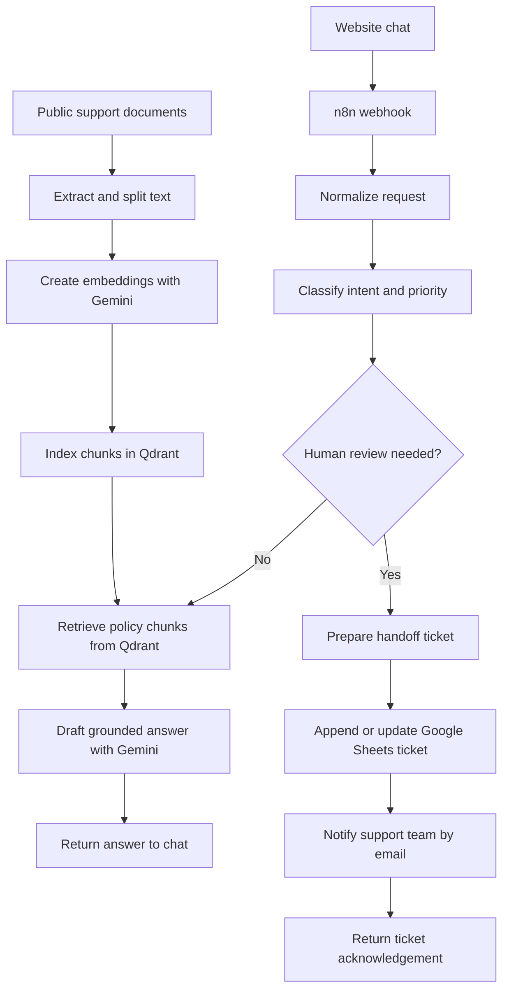
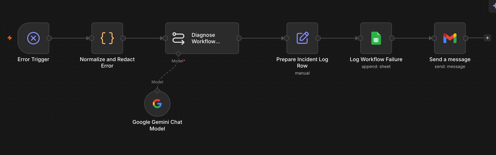
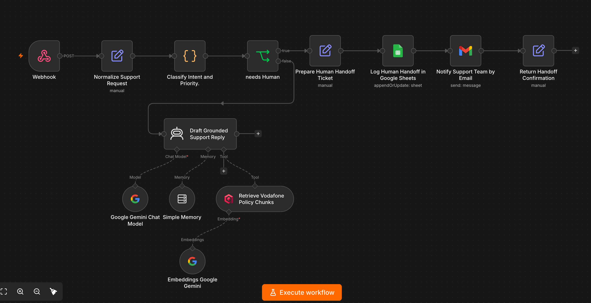
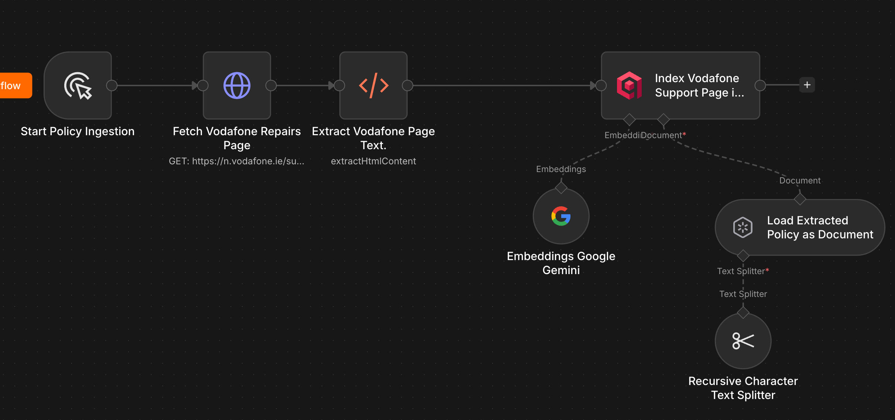
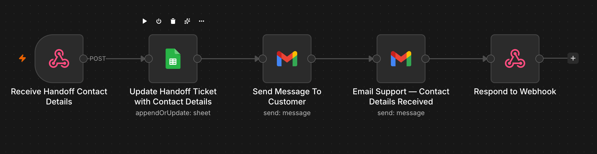

# SupportPilot AI — Customer Support Automation

An independent portfolio demo of an AI customer-support assistant built with n8n. It answers policy questions from indexed Vodafone Ireland support material and creates a human-review ticket when a request needs an agent.

> **Practice project only.** This is not affiliated with, endorsed by, or operated by Vodafone. It does not connect to customer accounts, order systems, or billing systems. Use fictional information only.

## What it demonstrates

- **Retrieval-augmented generation (RAG):** indexes public support documents and retrieves relevant passages before drafting a policy answer.
- **Vector search:** stores document embeddings in Qdrant and searches semantically relevant chunks.
- **AI response drafting:** uses Google Gemini embeddings and a Gemini chat model, with retrieved source text grounding the response.
- **Intent and priority routing:** classifies incoming questions and routes requests that need a person to human review.
- **Ticket logging:** records demo handoffs in Google Sheets and updates ticket rows when additional contact details arrive.
- **Notifications:** emails the support team and sends a customer-facing ticket acknowledgement in the demo flow.
- **Website chat demo:** sends chat messages to an n8n webhook and supports starting a fresh conversation.
- **Error handling:** captures workflow failures for diagnosis and tested recovery.

## Architecture

## Workflow screenshots

## Tools

- **n8n** — workflow orchestration and webhooks
- **Qdrant** — vector database for policy chunks
- **Google Gemini** — embeddings and response generation
- **Google Sheets** — demo ticket tracking
- **Gmail** — support and customer notifications
- **HTML, CSS, JavaScript** — browser chat interface
- **Docker** — local Qdrant setup

## Example flow

1. A visitor asks a policy question in the chat widget.
2. n8n normalizes the request and classifies its intent and priority.
3. For routine questions, the workflow retrieves relevant policy text from Qdrant and drafts a grounded response.
4. For complaints, account-specific questions, or other requests requiring a person, the workflow creates or updates a demo ticket, notifies support, and returns a handoff acknowledgement.
5. The chat can ask for fictional contact details so the demo ticket contains callback information.

## Run your own demo

This repository documents the project; it does **not** contain the original n8n workflow export or any credentials. To recreate it:

1. Run n8n and Qdrant in a local or hosted environment.
2. Create a Qdrant collection and configure the Gemini embedding model in n8n.
3. Import public support documents that you are permitted to use, extract and split their text, then index the chunks in Qdrant.
4. Build the support workflow shown above and connect Google Sheets and Gmail credentials through n8n's credential manager.
5. Point the chat widget at your own webhook URL. Keep credentials and webhook secrets out of browser code and GitHub.
6. Test with fictional questions and contact information before enabling the workflow for other users.

## Scope and limitations

- Responses are a demonstration and may be incomplete or stale; verify policy details against the source material.
- The demo cannot look up bills, orders, account records, or customer-specific status.
- Ticket storage and email delivery require the owner to configure their own Google credentials and destination sheet.
- The public repository intentionally excludes workflow exports, credentials, customer records, and private webhook URLs. Add a sanitized workflow export only after reviewing it for secrets and personal data.
- Cancellation-to-retentions routing is a possible extension and is not described as implemented here.

## Next steps

- Add a sanitized n8n workflow export and screenshots after a secrets review.
- Add evaluation examples for correct retrieval, escalation decisions, and failure handling.
- Deploy the chat interface and n8n workflow to a secure environment with appropriate access controls.

## Disclaimer

Vodafone and related marks belong to their respective owners. Public support information is referenced only to demonstrate a personal learning project. This repository is not an official Vodafone product or service.
